# Radar Signal Processing: Pulse Compression, Pulse Accumulation, MTI, MTD with MATLAB Codes

\t  
MATLAB simulation results (LFM signal pulse compression, accumulation, MTD/MTI)  
More radar and communication MATLAB codes
%==========================================================================\n% Radar System Basic Testing\n% Includes pulse pressure, MTI and MTD\n% The MTI section can also be commented out.\n%==========================================================================\n% Radar parameters\nclc;clear all;close all\nj=sqrt(-1);         %\nc=3e8;              % Speed of light\nT_LFM=100e-6;       % Width of time\nB=10e6;             % LFM bandwidth\nfs=100e6;           % Sampling rate\nN=10;               % Expand N times\nPRI=T_LFM*N;        % \nM=32;               % Number of pulses\nfc=600e6;           % Frequency of operation\nlambda=c/fc;        % Wavelength\n% Target parameters\nv=[0 80 30];       % Use 0 velocity point targets for speed, ground clutter, etc.\nR=[10e3 2e3 100e3]; % Distance\nA=[0 1 1];         % Target Intensity Control\nfd=2*v/lambda;      %Doppler Frequency\ntau=2*R/c;          % latency\n​\ndisp(['Maximum range/Maximum unblurred distance: ',num2str(PRI*c/2)])\ndisp(['Maximum speed range: ',num2str(-1/PRI*lambda/2/2),'~',num2str(1/PRI*lambda/2/2)])\ndisp(['Resolution',num2str(c/(2*B))])\n%% Launch section\n% Generate linear frequency modulated signal\n[s,t]=genLFM(fs,0,B,T_LFM);len=length(s);\nS=abs(fftshift(fft(s)));\nff=(-len/2:len/2-1)*(fs/len);\n​\nfigure\nsubplot(221);plot(t,real(s))\nsubplot(222);plot(t,imag(s))\nsubplot(223);plot(ff,S)\n  
​  

## Images

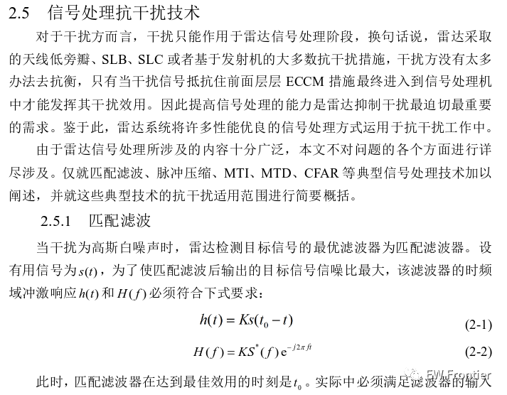
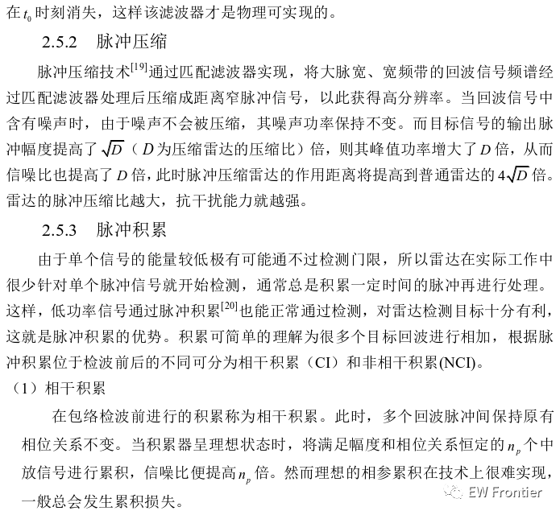
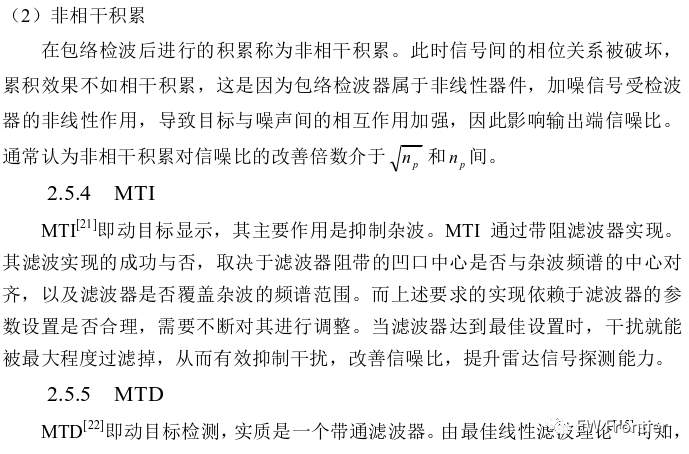
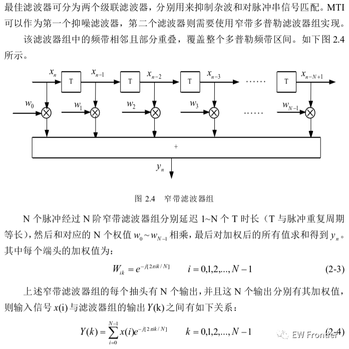
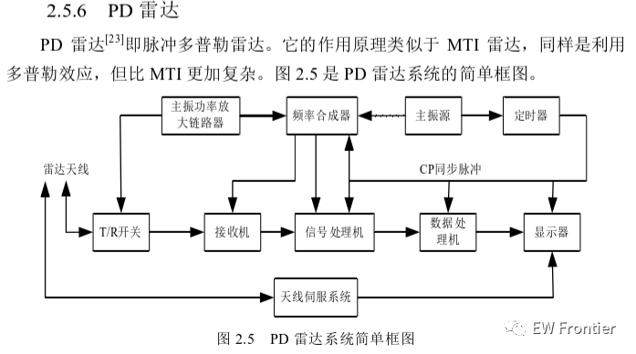
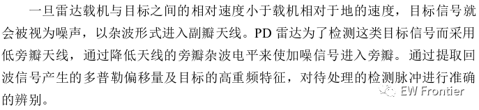
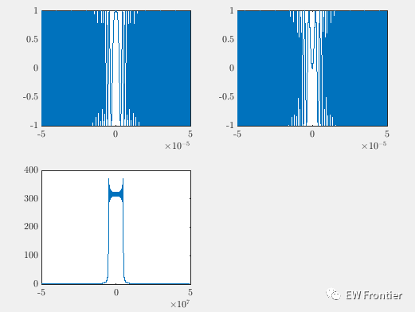
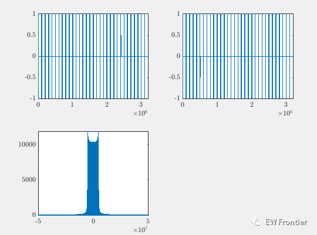
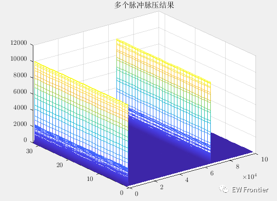
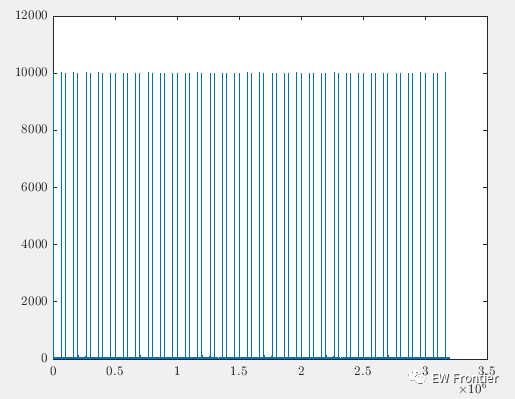
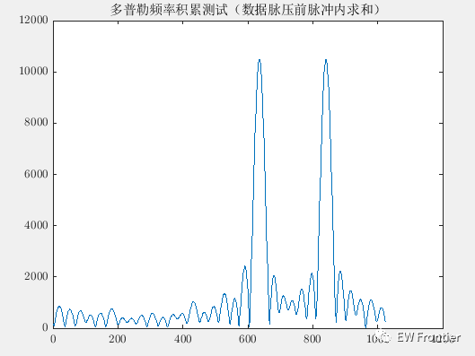
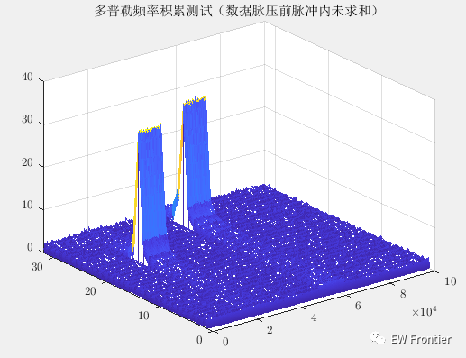
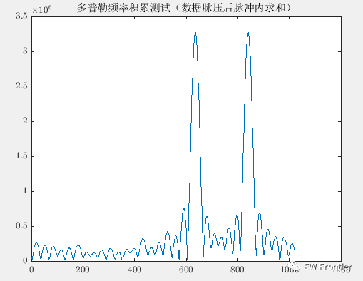
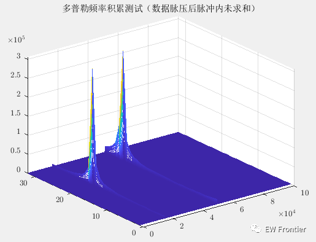
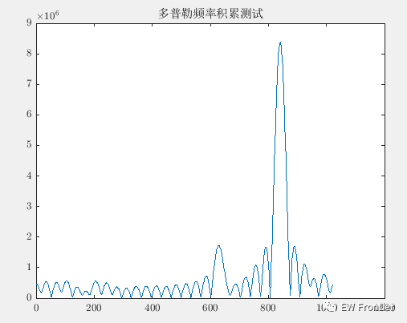
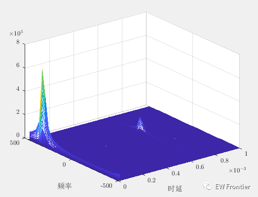

<!-- PAYMENT_BLOCK -->

## Get this dataset

- Payment link (Stripe): [Buy now](https://buy.stripe.com/3cs8yP7sY87d0vu9AB)
- Payment QR code: 

<!-- /PAYMENT_BLOCK -->
